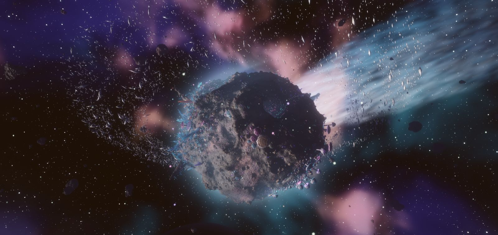

# 15 Eunomia

**A small asteroid you can land on, walk around and fly off, right in your browser.**

Crystal groves, glowing fungi, a gate humming in its biggest crater, an ice ring overhead and a comet tail streaming away from the star.
All of it is made by code: no images, no 3D models, no sound files. The whole world fits in **one 86 KB HTML file**.



## Try it

1. Download [`index.html`](index.html).
2. Open it in **Chrome** or **Edge** on a desktop computer.
3. Wait a few seconds while the asteroid is built, then click to land.

Nothing to install, and it works offline. It needs a browser with **WebGPU**. If you see *"This scene needs WebGPU"*, update your browser or switch to Chrome / Edge.

## What's out there

- **A round, cratered asteroid** about 110 m across, with a canyon, three rock horns, and a shaft that runs right through it to a hollow crystal core
- **A ring gate** with a swirling membrane in the largest crater, circled by crystal spires
- **Crystal groves**, glowing fungus woods with lanterns drifting up out of them, moss and grass, and jets of sparks from three vents
- **An ice ring and three moonlets** in orbit, wisps of light circling low, and far debris
- **A glowing atmosphere** and a tail of gas and dust blown off by the star
- **A ringed gas giant** with two moons, an ice planet, a galaxy band and a nebula
- **A soundscape** made up as you listen: a low rumble, a drone, chimes, footsteps, a thud when you land and a roar when you thrust

## Controls

| | Keyboard & mouse |
|---|---|
| Look around | Move the mouse |
| Walk, or thrust when in the air | `W` `A` `S` `D` |
| Jump, hold to thrust up | `Space` or `E` |
| Thrust down | `Q` |
| Boost | Hold `Shift` |
| Jump to a viewpoint | `1` to `6` |
| Pause | `Esc` releases the mouse and shows the list of controls; click to resume |
| Sound on / off | `M` |
| Performance stats | `H` |
| Quality | **Low**, **Medium** or **High** in the corner of the start page (reloads the page) |

Down is always toward the middle of the asteroid. On the ground you walk and stop when you let go. Off the ground nothing slows you down: thrust adds to the speed you already have, gravity weakens with distance, and you can put yourself in orbit. Fly too far and the asteroid gently pulls you back.

The rock is solid, and so are the moonlets. Plants, crystals, the gate and the ice ring you pass through.

**On a touchscreen:** hold one finger down to move and slide it to look. Put a second finger down to boost. The `≡` button in the corner pauses. (Touch is untested.)

## How it works

- The asteroid is sculpted on your graphics card every time the page opens, then dressed with hundreds of thousands of blades of moss and grass, tens of thousands of rocks, and thousands of crystals and fungi.
- Everything is drawn with **WebGPU** directly. No game engine or 3D library is used.
- The gate, crystals, fungi and rocks are built from simple mathematical shapes.
- The sky (stars, nebula, planets and the star) is painted by a shader, and the atmosphere and tail are traced through on every frame.
- The sound is synthesized live with the Web Audio API.
- It lowers the resolution and then the draw distance, in small steps, to hold 60 fps on slower hardware.

## Make it your own

The readable source code is in the [`source`](source) folder. To change something and rebuild `index.html` you need [Node.js](https://nodejs.org) 18 or newer:

```bash
cd source
npm install
npm run build
```

This writes a new `index.html` next to this README. `npm run build:dev` writes a separate `dev.html` with development tools: `F` flies the camera round the asteroid, `B` runs that flight as a benchmark, and console hooks let you place the camera and step frames by hand.

| File | What's inside |
|---|---|
| [`source/src/world.js`](source/src/world.js) | The layout: where the gate, groves, woods, canyon and shaft are, the moonlets, the ice ring, and every mesh. **A good place to start.** |
| [`source/src/shaders.js`](source/src/shaders.js) | The look: the asteroid's shape, rock and crystal materials, the sky, the atmosphere and tail (WGSL shader code) |
| [`source/src/main.js`](source/src/main.js) | The renderer, the camera, gravity, walking, the jetpack, collision, the start page and the six viewpoints |
| [`source/src/audio.js`](source/src/audio.js) | The soundscape |
| [`source/src/quality.js`](source/src/quality.js) | The quality levels: which one a device starts on, and what is remembered between visits |
| [`source/src/math.js`](source/src/math.js) | Noise, random numbers and mesh-building helpers |
| [`source/src/dev.js`](source/src/dev.js) | Development tools, only in `dev.html` |
| [`source/template.html`](source/template.html) | The page around the scene: loading line, start page, pause page and hints |
| [`source/tools/shoot.mjs`](source/tools/shoot.mjs) | Takes screenshots of `dev.html` in headless Chrome |

Some easy first tweaks:

- **Size of the asteroid:** `R0` at the top of `world.js` (the shape itself is `W_DENS` in `shaders.js`)
- **Starlight colour:** `SUNC` near the top of the shared scene code in `shaders.js`
- **Brightness and atmosphere:** `EXPO` and `RAYS` in `main.js`
- **Walking speed:** search for `fast ? 11 : 5.5` in `main.js` (boost : normal)
- **Jetpack strength:** search for `fast ? 16 : 8` in `main.js`

## Credits

This version is by JNobleA. It is built on the renderer of [Abyssal Garden](https://github.com/Noniv/abyssal-garden) by Noniv; the world, its contents, the lighting, the movement and the start page are new.

## License

[MIT](LICENSE): free to use, change and share, including in your own projects.
